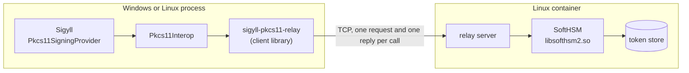
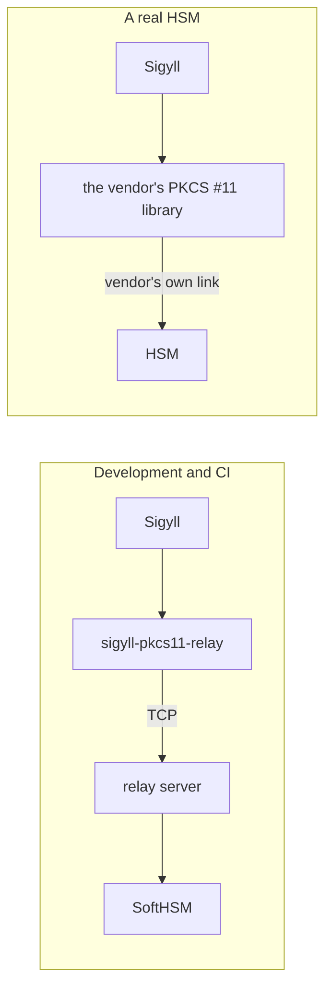
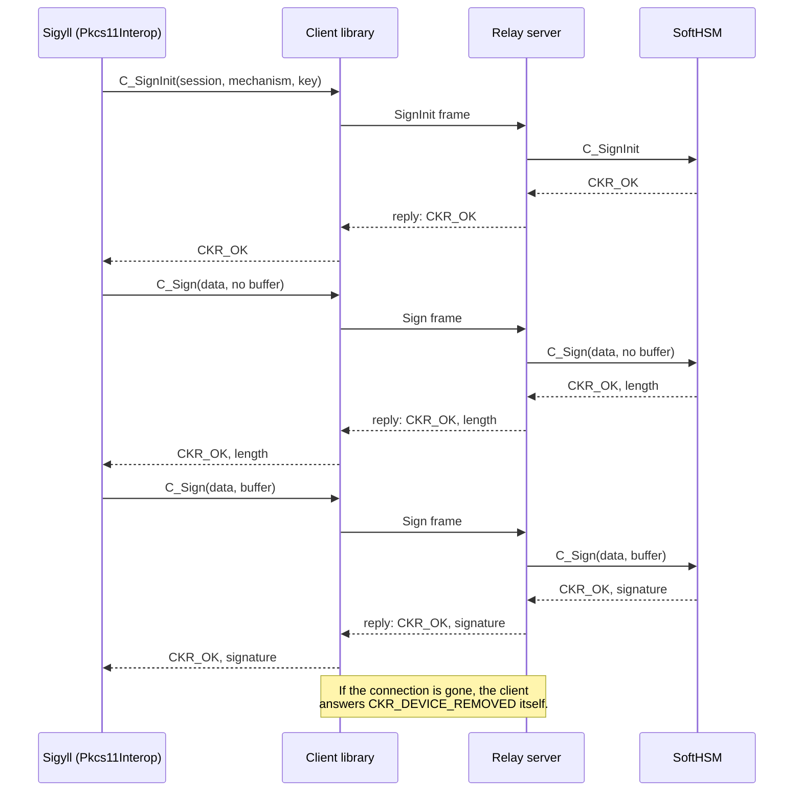
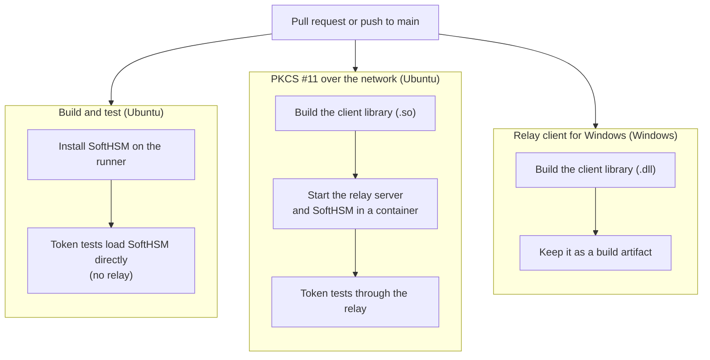

# PKCS #11 relay

A stand-in for a network HSM, for development and tests.

Sigyll reaches an HSM through PKCS #11: it loads the HSM vendor's library into its own process and calls it. With a
network HSM, that library talks to the appliance over the network and Sigyll never sees the connection. The relay
recreates that arrangement with open-source parts:

- **Client library** (`Client/`): a PKCS #11 library that forwards each call over TCP. It is a native library
  (`sigyll-pkcs11-relay.dll` on Windows, `.so` on Linux), built from C# with Native AOT, and is loaded exactly like
  a vendor's library.
- **Server** (`Server/`): receives the calls and passes them to a real PKCS #11 library. In the container built by
  the `Dockerfile` that library is SoftHSM.

> [!WARNING]
> For development and tests only. The connection is neither encrypted nor authenticated, so the PIN crosses it in
> the clear; run the server on the local machine only. A real HSM is used through its vendor's library, with
> nothing in between.

## Why it exists

- SoftHSM has no maintained Windows build, so a Sigyll running on Windows (as it does under the AppHost) has no
  PKCS #11 token to load. With the relay it uses SoftHSM in a container.
- The daily run goes through the Windows form of PKCS #11 (4-byte `CK_ULONG`, structures packed to one byte),
  which is the form a vendor's Windows library uses.
- A lost connection reaches Sigyll as `CKR_DEVICE_REMOVED`, the way a network HSM's library reports one, so
  Sigyll's recovery can be tested.

## How the parts fit



Swapping in a real HSM changes one setting, `Pkcs11:LibraryPath`, and removes the relay from the picture:



## One call, end to end

Signing, as an example. PKCS #11 callers ask twice: once without a buffer to learn the signature's length, then
with one. Both calls go to the token, so the token's own rules decide the outcome.



## Running it

On Windows, with Docker running:

```powershell
./tools/pkcs11-relay/run-token-tests.ps1
```

The script builds the client DLL, starts the server container on `127.0.0.1:5696`, runs Sigyll's PKCS #11 tests
with the DLL as the library, and removes the container.

Building the DLL needs the Visual Studio C++ build tools ("Desktop development with C++", from Visual Studio or
from Build Tools for Visual Studio). Native AOT cannot build for another operating system, so the Windows DLL is
built on Windows and the Linux library on Linux (with `clang` and `zlib1g-dev`).

By hand:

```powershell
dotnet publish tools/pkcs11-relay/Client -c Release -r win-x64 -o out
docker build -t sigyll-pkcs11-relay tools/pkcs11-relay
docker run -d --name relay -p 127.0.0.1:5696:5696 sigyll-pkcs11-relay
# then point Pkcs11:LibraryPath (or SIGYLL_TEST_PKCS11_LIB for the tests) at out/sigyll-pkcs11-relay.dll
```

### Settings

| Where | Variable | Meaning | Default |
|---|---|---|---|
| Client | `SIGYLL_PKCS11_RELAY` | Server address, `host:port` | `127.0.0.1:5696` |
| Server | `PKCS11_RELAY_LIBRARY` | The PKCS #11 library to pass calls to | `/usr/lib/softhsm/libsofthsm2.so` |
| Server | `PKCS11_RELAY_PORT` | Port to listen on | `5696` |

## How CI uses it



The Windows job only builds the DLL: GitHub's Windows runners cannot run the Linux container the server needs. The
full run on Windows is `run-token-tests.ps1` on a developer's machine.

## What is forwarded

| Group | Functions |
|---|---|
| Library | `C_Initialize`, `C_Finalize`, `C_GetInfo`, `C_GetFunctionList` |
| Slots and tokens | `C_GetSlotList`, `C_GetSlotInfo`, `C_GetTokenInfo`, `C_GetMechanismList`, `C_GetMechanismInfo`, `C_InitToken`, `C_InitPIN` |
| Sessions | `C_OpenSession`, `C_CloseSession`, `C_GetSessionInfo`, `C_Login`, `C_Logout` |
| Objects | `C_FindObjectsInit`, `C_FindObjects`, `C_FindObjectsFinal`, `C_GetAttributeValue`, `C_DestroyObject` |
| Keys and signing | `C_GenerateKeyPair`, `C_SignInit`, `C_Sign` |

Every other function answers `CKR_FUNCTION_NOT_SUPPORTED`. To add one: give it a number in `Shared/Wire.cs`, an
entry point and a place in the function list in `Client/Exports.cs`, and a case in `Server/Program.cs`.

## The wire format

One request and one reply per call, each a 4-byte little-endian length followed by the payload. A request starts
with the function's number, a reply with the PKCS #11 return value.

A `CK_ULONG` is 4 bytes on Windows and 8 on 64-bit Linux, so on the wire it is always 8. The client library widens
and narrows values as they cross, including the value of an attribute that is itself a `CK_ULONG` (`CKA_CLASS`,
`CKA_KEY_TYPE`, `CKA_MODULUS_BITS` and the like; the list is in `Client/Cryptoki.cs`). The server runs where a
`CK_ULONG` is already 8 bytes and passes attribute values through untouched.

## Limits

- A mechanism's parameter travels as plain bytes. That is right for the mechanisms Sigyll uses, which have none.
  A parameter structure that holds `CK_ULONG`s (RSA-PSS, for one) would need translating in the client.
- The server keeps one library for every connection, and a PKCS #11 library keeps one login per token for its
  whole process. Two clients connected at once therefore share a login.
- A client that disconnects loses its sessions, as on a network HSM. Notification callbacks are not relayed.
- The server is written for 64-bit Linux.
